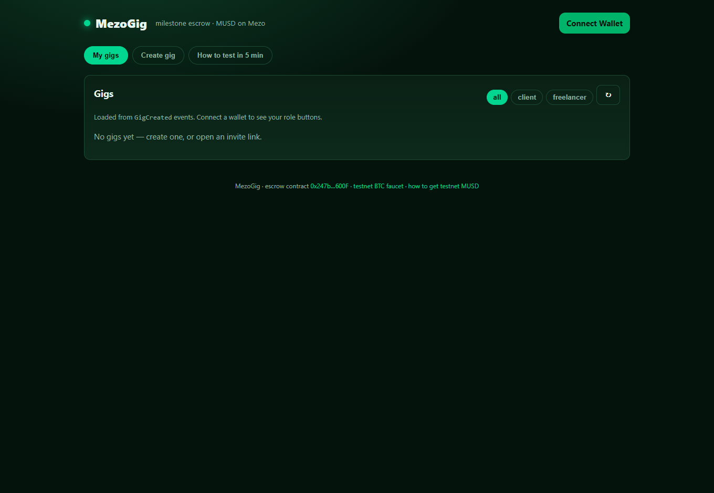
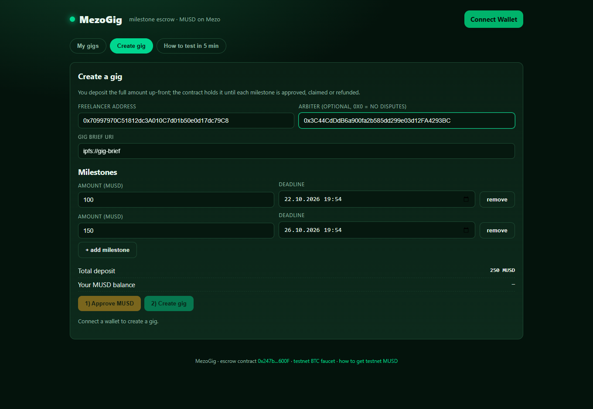
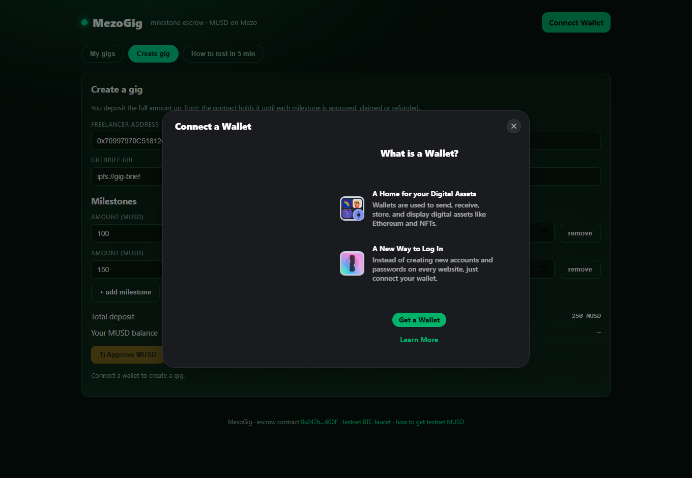
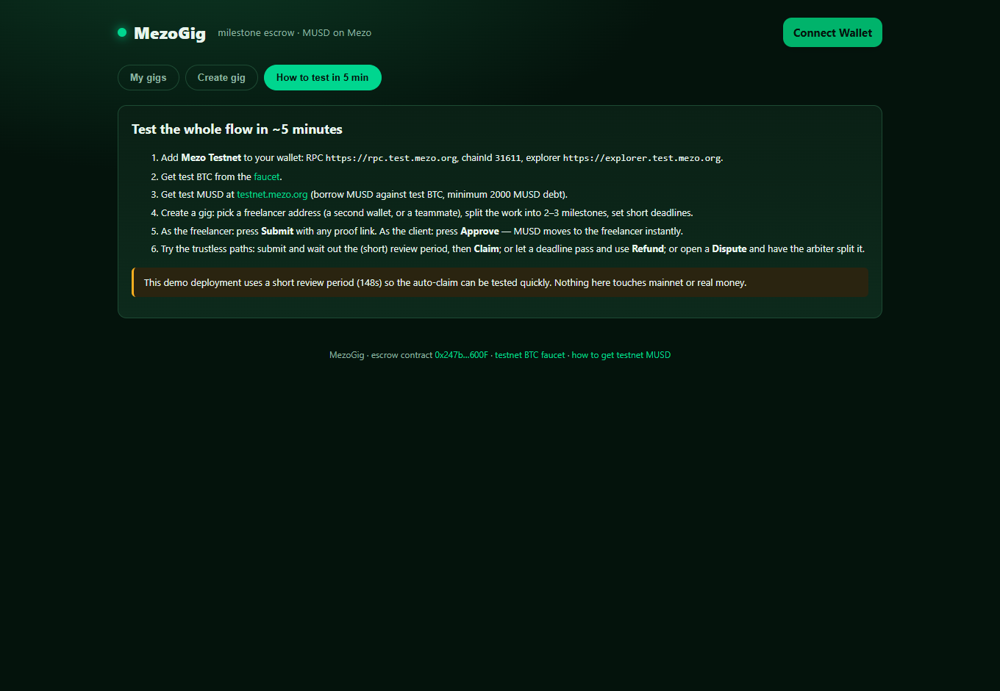

# MezoGig — milestone escrow for freelance work, settled in MUSD on Mezo

> Hackathon project for **AKINDO “Build with MUSD and MEZO”**.
> Testnet only. No real money, no platform fee, no admin keys.

**Status**

| | |
|---|---|
| Contract | `contracts/MezoGigEscrow.sol` — compiled with solc 0.8.28, `evmVersion: london` |
| Tests | **79 passing** (`npm test`) |
| Coverage | **100 % statements / 92 % branches / 100 % functions / 100 % lines** (escrow) — [`docs/COVERAGE.md`](docs/COVERAGE.md) |
| Static analysis | Slither 0.11.6 — 6 findings, all reviewed — [`docs/SLITHER_REPORT.md`](docs/SLITHER_REPORT.md) |
| Local end-to-end | full lifecycle executed on a local chain, tx list — [`docs/DEMO.md`](docs/DEMO.md) |
| Testnet deploy | **deployed** on Mezo Testnet — `0x247b313d0eD3C532B16c7E5f9eA760272361600F`, block `16247351`, tx `0xc9ea7697…ad7e44` |
| Verification | **Sourcify `exact_match`** (creation + runtime) — [repo record](https://repo.sourcify.dev/contracts/full_match/31611/0x247b313d0eD3C532B16c7E5f9eA760272361600F/) |
| Repository | **public** — <https://github.com/mak777uh/mezogig> (MIT) |
| Live demo | **<https://mak777uh.github.io/mezogig/>** — GitHub Pages, Mezo Testnet wired in |

## The problem

Freelancers who take work from strangers have no payment guarantee. If they deliver first, the client can
disappear. If the client pays first, the money is gone before the work exists. On-chain escrow fixes the
incentive problem, but “send the whole budget to a contract and hope” is not enough: real gigs are split
into **milestones**, and each milestone can go wrong in its own way (not delivered, delivered late,
delivered but disputed).

Crypto freelancing has a second problem: budgets are usually quoted in a volatile asset. Mezo solves it
with **MUSD**, a BTC-collateralised stablecoin. The freelancer is paid in a stable unit, the client keeps
their BTC exposure, and the escrow contract never touches BTC — it only moves MUSD.

## The solution

`MezoGigEscrow` holds the **entire gig budget up-front** and releases it one milestone at a time:

| Step | Who | What happens |
|---|---|---|
| `createGig` / `createGigWithPermit` | client | Deposits `sum(amounts)` MUSD in one transfer (plain `approve` or an EIP-2612 permit). Each milestone gets an amount and a deadline. |
| `submitMilestone` | freelancer | Delivers before the deadline, attaches a proof URI. |
| `approveMilestone` | client | Accepts; the milestone amount goes to the freelancer. |
| `claimMilestone` | freelancer | If the client stays silent for `reviewPeriod`, the freelancer claims automatically. |
| `refundExpired` | client | Milestone not submitted before its deadline → the client gets it back. |
| `openDispute` | either party | Freezes a milestone for the arbiter chosen at gig creation. |
| `resolveDispute` | arbiter | Splits the milestone: `bps` to the freelancer, the rest back to the client. |
| `proposeCancel` / `confirmCancel` / `revokeCancel` | both parties | Mutual cancellation: both signatures required, pending funds return to the client. |

Every state change emits an event, and every payout is bounded by the milestone amount, so **the contract
can never pay out more than it took in**.

### State machine

```
gig:        Active ──▶ Completed
              └────▶ Cancelled (mutual, both signatures)

milestone:  Pending ──submit──▶ Submitted ──approve──────────▶ Paid
               │                    │  └──claim (after review)──▶ Paid
               │                    └──openDispute──▶ Disputed ──resolve──▶ Resolved
               ├──deadline passed──▶ Refunded
               └──openDispute──────▶ Disputed
```

## Deployed contracts

| Network | Contract | Address |
|---|---|---|
| Local (verification run) | `MezoGigEscrow` | `0xe7f1725E7734CE288F8367e1Bb143E90bb3F0512` + `MockMUSD` — see [`docs/DEMO.md`](docs/DEMO.md) |
| **Mezo Testnet (31611)** | `MezoGigEscrow` | [`0x247b313d0eD3C532B16c7E5f9eA760272361600F`](https://explorer.test.mezo.org/address/0x247b313d0eD3C532B16c7E5f9eA760272361600F) — deploy tx [`0xc9ea7697…`](https://explorer.test.mezo.org/tx/0xc9ea76977cd4840160378e2ce3d52269a22dc090f5b3daeed0ec68a562ad7e44), verified on [Sourcify](https://repo.sourcify.dev/contracts/full_match/31611/0x247b313d0eD3C532B16c7E5f9eA760272361600F/) |
| Mezo Testnet | MUSD (ERC-20, 18 dec, permit) | [`0x118917a40FAF1CD7a13dB0Ef56C86De7973Ac503`](https://explorer.test.mezo.org/address/0x118917a40FAF1CD7a13dB0Ef56C86De7973Ac503) |

Live demo: **<https://mak777uh.github.io/mezogig/>** · public repository: **<https://github.com/mak777uh/mezogig>**.
The build is reproducible locally: `cd frontend && npm ci && npm run dev` (public values are committed in
`frontend/.env.production`; no secrets).

## Screenshots

| My gigs | Create gig |
|---|---|
|  |  |

| Connect wallet | How to test in 5 min |
|---|---|
|  |  |

Run the UI locally in two minutes: `cd frontend && npm ci && npm run dev` (Mezo Testnet is wired in; without
a WalletConnect project id the app uses injected wallets and the console stays clean).

## Deck & 2-minute video

- Deck: [`docs/deck.pdf`](docs/deck.pdf) — 8 slides: problem → solution → how MUSD works in the escrow →
  demo → technical/security → business → roadmap → team.
- Video: [`docs/demo.mp4`](docs/demo.mp4) — 113 s, captioned, screen-only (no voice, no face).

## Test it in ~5 minutes1. **Add Mezo Testnet** to your wallet: RPC `https://rpc.test.mezo.org`, chainId `31611`, symbol `BTC`,
   explorer `https://explorer.test.mezo.org`.
2. **Get test BTC** from the faucet: <https://faucet.test.mezo.org>.
3. **Get test MUSD**: at <https://testnet.mezo.org>, borrow MUSD against your test BTC (minimum 2000 MUSD
   debt). Testnet MUSD is `0x1189…c503`.
4. Open the demo, connect the wallet, press **Create gig**: freelancer = a second wallet (or a teammate’s
   address), two milestones (`100` and `150` MUSD), deadlines a few minutes apart, arbiter = a third address
   (or `0x0` to disable disputes). Press **Approve MUSD**, then **Create gig**.
5. Copy the **invite link** from the gig card and open it with the freelancer wallet: **Submit** a milestone
   with any proof link. Back on the client wallet: **Approve & pay** — MUSD moves immediately.
6. Try the trustless paths: submit and wait out the demo review period, then **Claim**; let a deadline pass
   and use **Refund**; open a **Dispute** and resolve it from the arbiter wallet with e.g. `5000` bps;
   propose **cancel** from one wallet and accept from the other.

The demo deployment uses a **short review period** (148 s by default) so the auto-claim can be tested
without waiting days.

## Agent console (read-only + dry-run)

`scripts/agent-console.js` is a machine-readable interface for agents and DAOs. It never prints private
keys and sends no transaction unless `--send` is passed explicitly (do not use `--send` for the public
testnet submission).

```bash
npm run agent -- status --json        # contract, MUSD, review period, gigs, milestones
npm run agent -- jobs list            # same, human-readable
npm run agent -- job get 1 --json     # one gig, full milestone detail
npm run agent -- watch 1 --interval 5 # print on status/milestone/claimable changes
npm run agent -- verify --json        # chainId, MUSD match, reviewPeriod; exit 0/2
```

Lifecycle commands build **calldata only** by default:

```bash
npm run agent -- job create --worker 0x... --amount 100 --milestones 3 --dry-run --json
npm run agent -- job submit 1 --index 0 --proof ipfs://... --dry-run --json
npm run agent -- job approve 1 --index 0 --dry-run --json
npm run agent -- job release 1 --index 0 --dry-run --json
npm run agent -- job dispute 1 --index 0 --dry-run --json
```

`job fund <id>` is intentionally not implemented: `createGig` funds the whole budget atomically and the
contract has no top-up function.

Exit codes: `0` success, `1` input error, `2` network/contract error, `3` contract revert with a reason.
RPC and escrow default to the public Mezo Testnet deployment and can be overridden with `--rpc`,
`--escrow`, `MEZO_RPC_URL`, or `MEZOGIG_ESCROW`.

Read-only check against the deployed contract (23.10.2026): chainId `31611`, `musdMatches: true`,
`reviewPeriodSeconds: 148`, `gigCount: 0` (no funded gigs on the public testnet — testnet MUSD requires
borrowing against test BTC; this is stated in `docs/DEMO.md`).

## Repository layout

```
contracts/
  MezoGigEscrow.sol        # the escrow contract (no owner, no fee, immutable token)
  mocks/MockMUSD.sol       # local-only ERC-20 + permit used by tests and the local demo
  mocks/ReentrantMUSD.sol  # malicious token used to attack every payout path
test/
  MezoGigEscrow.test.js    # happy paths, negative cases, accounting invariants, fuzz
  Guards.test.js           # terminal-state guards, uint128 bound, frozen disputes
  Reentrancy.test.js       # nonReentrant holds on every payout path
scripts/
  deploy.js                # deploys (auto-deploys MockMUSD on localhost) + writes deployments/<net>.json
  export-abi.js            # copies the ABI into the frontend
  demo.js                  # end-to-end flow: approve, auto-claim, dispute split, mutual cancel
  agent-console.js         # read-only / dry-run CLI for agents and DAOs (see "Agent console")
frontend/                  # Vite + React + wagmi/viem + RainbowKit, Mezo Testnet wired in
deployments/               # deploy receipts
docs/
  SECURITY.md              # threat model, invariants, limitations
  TESTING.md               # what the tests cover and why
  COVERAGE.md              # coverage numbers and the viaIR note
  SLITHER_REPORT.md        # static analysis results and dispositions
  DEMO.md                  # executed demo, tx hashes, testnet checklist
```

## Run tests

```bash
npm install
npm run compile
npm test          # 79 passing (69 contract + 10 agent-console)
npm run coverage  # 100 % stmts / 92 % branch / 100 % funcs (escrow)
```

## Deploy

```bash
cp .env.example .env       # put a THROWAWAY testnet key in DEPLOYER_PRIVATE_KEY
npm run deploy:mezo
# -> deployments/mezoTestnet.json (address, tx hash, review period)
node scripts/export-abi.js
cd frontend && cp .env.example .env   # VITE_ESCROW_ADDRESS, VITE_DEPLOY_BLOCK
npm install && npm run build
```

Verify on the explorer (Blockscout-compatible endpoint):

```bash
# The Mezo testnet explorer has no Etherscan-compatible API, so verification goes through Sourcify v2
# (chain 31611 is supported). Result for this deployment: exact_match on creation + runtime.
npm run verify:sourcify
# manual values if you ever need them: solc 0.8.28, optimizer 200 runs, evmVersion london,
# constructor args (0x118917a40FAF1CD7a13dB0Ef56C86De7973Ac503, 148)
```

## Security

Full threat model: [`docs/SECURITY.md`](docs/SECURITY.md). Summary:

- **No owner, no admin, no fee, no upgradeability.** MUSD leaves the contract only through the five payout
  paths above, each bounded by one milestone’s amount and guarded by a role and a state check.
- **Accounting invariant:** `paidOut + refunded ≤ funded`, each milestone settles exactly once. Fuzz tests
  assert this over randomized amounts, splits and terminal paths.
- **Checks-effects-interactions**, `nonReentrant` everywhere, `SafeERC20`, immutable token address.
- **Reentrancy proven, not assumed:** a malicious ERC-20 attacks every payout path in
  `test/Reentrancy.test.js`; all six attacks are rejected by the guard, the outer call still settles once.
- No `delegatecall`, no `selfdestruct`, no `tx.origin`, no arbitrary transfers. MIT licensed, testnet only,
  not a third-party-audited product.

## License

MIT — see `LICENSE`.
